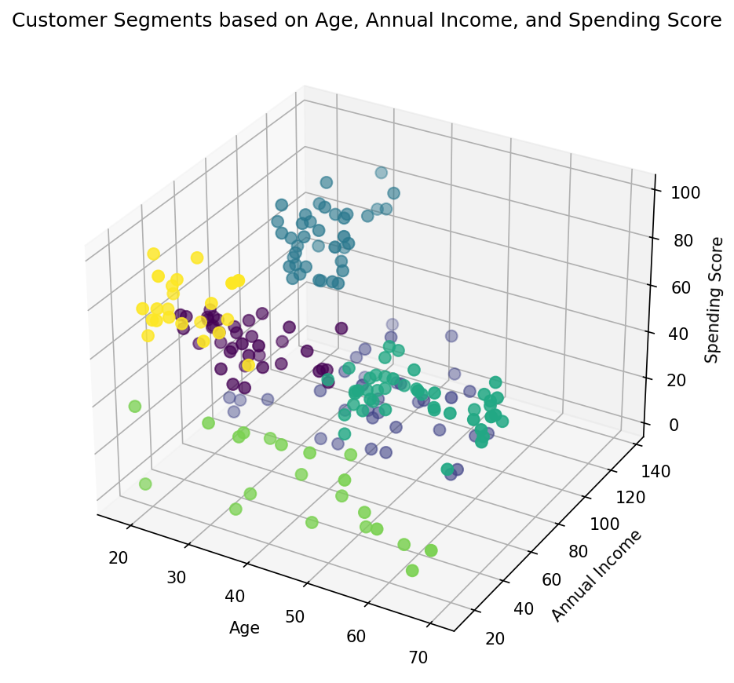
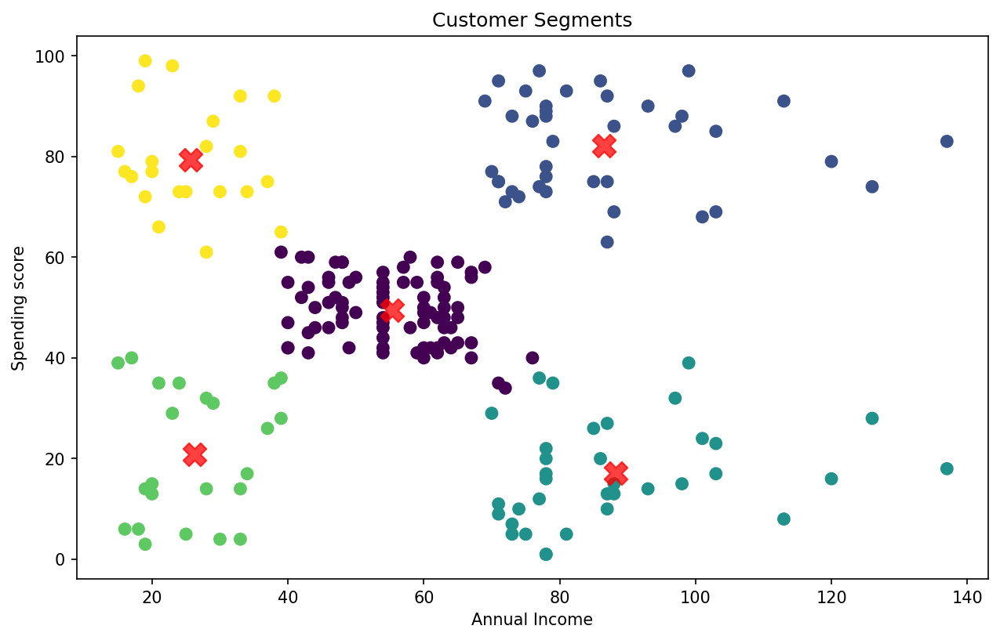
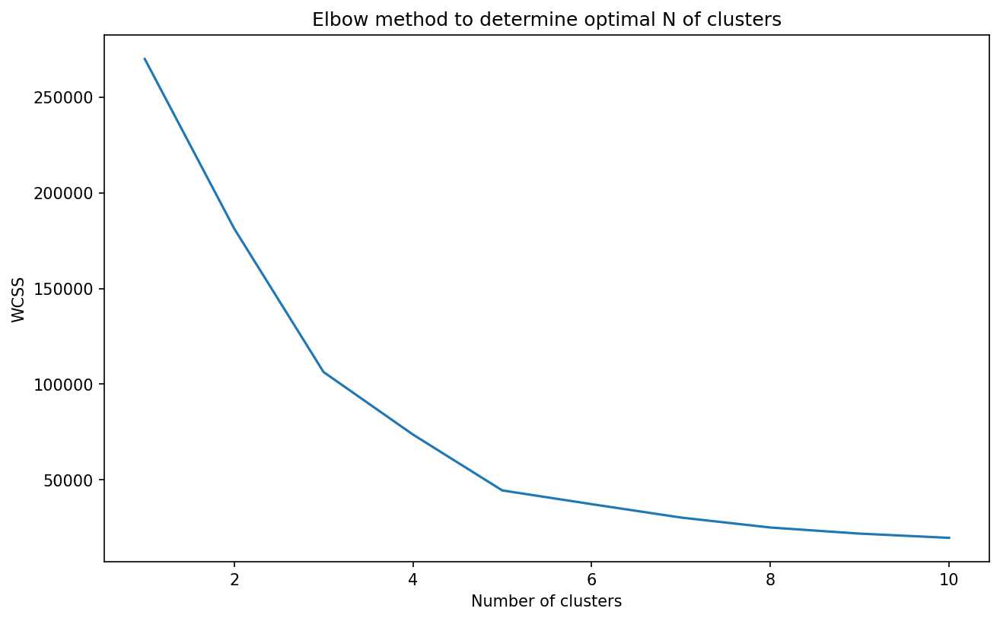
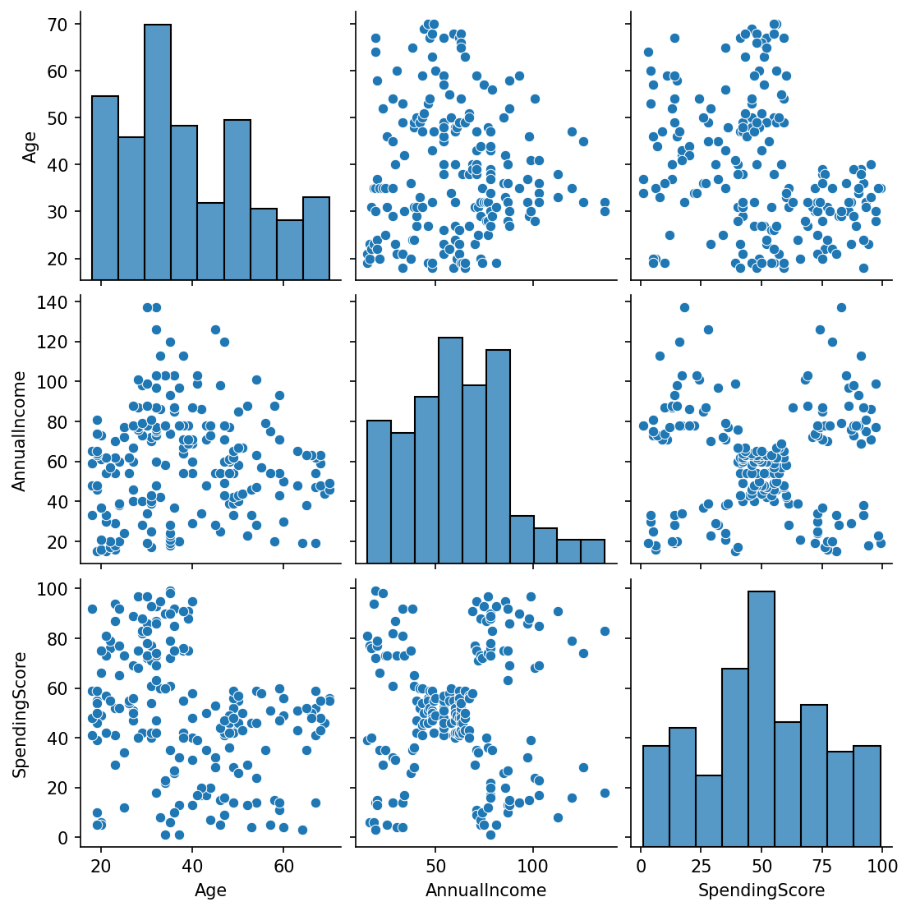

# 🛍️ Customer Segmentation with K-Means Clustering (Python Project)

## 📌 Project Overview

This project uses K-means clustering in Python to group mall customers into segments based on their age, annual income, and spending score. The goal is to find natural customer groups that a business could target with different marketing strategies.

The dataset covers 200 mall customers. The analysis explores the data, uses the elbow method to choose the number of clusters, and builds three segmentation models: income and spending, age and spending, and all three features together. The final 6-segment model is profiled and turned into business recommendations.

## 🎯 Key Features

✅ Data Exploration: Reviewed summary statistics, checked for missing values, and visualized feature relationships with a pair plot. 
✅ Elbow Method: Plotted within-cluster sum of squares (WCSS) for 1 to 10 clusters to choose the number of segments. 
✅ Two-Feature Models: Segmented customers by income and spending (5 clusters) and by age and spending (4 clusters). 
✅ Three-Feature Model: Segmented customers by age, income, and spending together (6 clusters). 
✅ Cluster Centers: Marked each segment's center on the 2D charts. 
✅ 3D Visualization: Plotted all three features in an interactive-style 3D scatter chart. 
✅ Segment Profiles: Calculated the average age, income, and spending score of each segment and turned them into business actions. 
✅ Reproducible Results: Set `random_state = 0` so the clusters come out the same on every run.

## 📷 Visualizations

### Customer Segments in 3D (Age, Income, and Spending)

### Customer Segments by Income and Spending

### Elbow Method for Income and Spending

### Feature Relationships

## 🗂️ Repository Files

| File | Description |
|------|-------------|
| `Mall_Customers.csv` | Raw dataset: 200 rows and 5 columns (CustomerID, Gender, Age, Annual Income, Spending Score) |
| `customer_segmentation_kmeans.ipynb` | Jupyter Notebook with the full code, models, and outputs |
| `pairplot_features.png` | Pair plot of age, annual income, and spending score |
| `income_vs_spending_raw.png` | Annual income vs spending score before clustering |
| `age_vs_spending_raw.png` | Age vs spending score before clustering |
| `elbow_income_spending.png` | Elbow plot for the income and spending model |
| `elbow_age_spending.png` | Elbow plot for the age and spending model |
| `elbow_age_income_spending.png` | Elbow plot for the three-feature model |
| `segments_income_spending.png` | 5 segments by income and spending, with cluster centers |
| `segments_age_spending.png` | 4 segments by age and spending, with cluster centers |
| `customer_segments_3d.png` | 6 segments by age, income, and spending in 3D |

## 🧹 Data Preparation

- Loaded the data with `pd.read_csv()` using a relative file path, so the notebook runs from any computer.
- Renamed the columns `Annual Income (k$)` and `Spending Score (1-100)` to `AnnualIncome` and `SpendingScore` to make them easier to work with.
- Confirmed the dataset has no missing values.
- Reviewed summary statistics: average age of 38.9, average income of $60,600, and average spending score of 50.2.
- Selected Age, AnnualIncome, and SpendingScore as clustering features. CustomerID and Gender were left out.

## 🛠️ Skills & Tools Applied

- Language and Environment: Python, Jupyter Notebook (Anaconda)
- Libraries: pandas, Matplotlib, Seaborn, scikit-learn
- Machine Learning: K-means clustering (unsupervised learning) with `k-means++` initialization
- Model Selection: Elbow method using within-cluster sum of squares (WCSS)
- Visualization: Pair plot, 2D scatter plots with cluster centers, 3D scatter plot
- Data Storytelling: Turning cluster averages into named segments and business actions

## 📈 Business Questions Answered

This project provides insights into:

- What natural customer groups exist in the mall's customer base?
- Which customers spend the most, and what do they have in common?
- Which high-income customers are spending less than expected?
- How should marketing differ for each customer segment?

## 💡 Key Insights

The final model used all three features and found **6 customer segments**:

| Segment | Customers | Avg. Age | Avg. Income | Avg. Spending Score | Profile |
|---|---|---|---|---|---|
| 0 | 38 | 27.0 | $56.7k | 49.1 | Young average earners |
| 1 | 35 | 41.7 | $88.2k | 17.3 | Careful high earners |
| 2 | 39 | 32.7 | $86.5k | 82.1 | Premium spenders |
| 3 | 45 | 56.2 | $53.4k | 49.1 | Older steady shoppers |
| 4 | 21 | 44.1 | $25.1k | 19.5 | Budget-conscious shoppers |
| 5 | 22 | 25.3 | $25.7k | 79.4 | Young impulse spenders |

- **Premium spenders (Segment 2)** are the most valuable group. They earn about $86,500 and have the highest average spending score (82.1). **Action:** Target them with loyalty programs, early access, and premium products.
- **Careful high earners (Segment 1)** earn the most ($88,200) but spend the least of any higher-income group (17.3). **Action:** This is the biggest growth opportunity. Test quality-focused or value-focused campaigns to learn what would move them.
- **Young impulse spenders (Segment 5)** earn only about $25,700 but spend heavily (79.4). **Action:** Reach them with trend-driven promotions and social media, while watching for price sensitivity.
- **Budget-conscious shoppers (Segment 4)** have both low income and low spending. **Action:** Use discounts and value bundles rather than premium marketing.
- **Young average earners (Segment 0)** and **older steady shoppers (Segment 3)** have similar income and spending, but are about 29 years apart in age. **Action:** Keep the offers similar but change the message and channels for each age group.
- The two-feature income and spending model showed a clear **5-group pattern**, which is why the elbow plot bends at 5 clusters for that model.

*Note: The dataset is small (200 customers) and comes from a public practice dataset, so these segments show the method rather than a real store's customers. The features were not scaled before clustering. Income and spending score have similar ranges here, but scaling would be needed for features measured very differently. K-means also assumes clusters are roughly round and similar in size, which real customer data may not follow.*

## 🚀 Learning Outcomes

Building this project strengthened my skills in:

📌 Applying unsupervised machine learning to unlabeled data 
📌 Choosing the number of clusters with the elbow method 
📌 Comparing models built on different feature combinations 
📌 Visualizing clusters in 2D and 3D 
📌 Translating cluster averages into named segments and business actions

## 🔮 Next Steps

- Scale the features with `StandardScaler` before clustering and compare the results.
- Add silhouette scores to support the choice of cluster count alongside the elbow method.
- Include gender in the analysis to see whether it changes the segments.
- Apply the same method to real sales data, such as segmenting buyers by spend, purchase frequency, and product preferences.

## 📚 Dataset Source

[Mall Customer Segmentation Data](https://www.kaggle.com/datasets/vjchoudhary7/customer-segmentation-tutorial-in-python/data) by vjchoudhary7 on Kaggle.

## 🙌 Acknowledgment

This project was my first step into unsupervised machine learning. It showed me that the real value of clustering is not the colored chart, but the business decisions each segment makes possible.

## 🔗 Related Link

[LinkedIn Post](https://www.linkedin.com/in/YOUR-POST-LINK)

## 👨‍💻 Author

**Omar Shazley**: Data Analyst | Python, Excel, SQL, and healthcare data analytics

💼 [LinkedIn](https://www.linkedin.com/in/YOUR-PROFILE) 
💻 [GitHub Portfolio](https://github.com/Bromar95) 
📧 Email: [omarshazley@gmail.com](mailto:omarshazley@gmail.com)

✨ If you like this project, don't forget to ⭐ star the repo!
